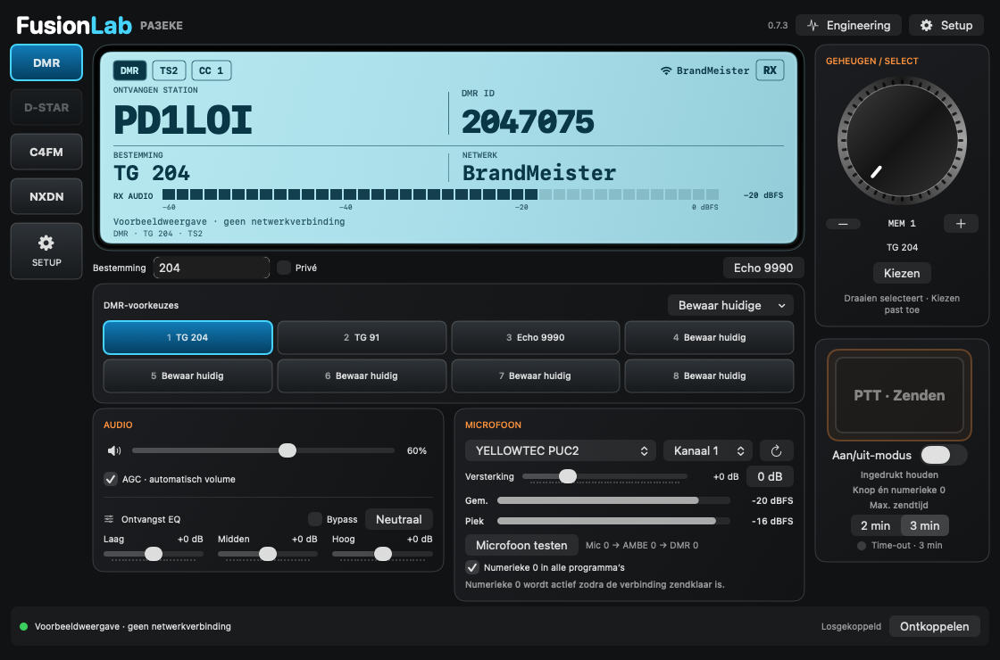

# FusionLab 0.7.3 — Fusion YSF, DMR / BrandMeister en NXDN

Aparte native macOS-app voor PA3EKE. MacDV blijft ongewijzigd. macOS 14 of nieuwer; gebouwd voor de architectuur van de Mac waarop je bouwt.



*GUI-voorbeeld uit de actuele broncode, met testgegevens en zonder radioverbinding. Ook beschikbaar: [C4FM](Docs/Screenshots/FusionLab-0.7.3-C4FM.png) en [NXDN](Docs/Screenshots/FusionLab-0.7.3-NXDN.png).*

FusionLab ondersteunt C4FM/Fusion DN via YSF, DMR via BrandMeister en NXDN4800. Kies een externe AMBEserver of de lokale MD380-vocoder. De radioconsole heeft acht voorkeuzes per mode, ontvangst-AGC, drieband-EQ, audio-mute en programmeerbare X-keys-bediening.

## Radioconsole

Klik links op **DMR**, **C4FM** of **NXDN** om van mode te wisselen. Tijdens een verbinding rondt FusionLab de oude netwerkverbinding af, initialiseert dezelfde vocoder voor de andere mode en verbindt automatisch opnieuw met de opgeslagen instellingen. Je hoeft daarvoor niet naar SETUP. Tijdens de overgang verschijnt **Wisselen naar…**; **Annuleren** stopt de overgang. Tijdens voorbereiden, zenden, afronden of een ingedrukte PTT-toets is wisselen geblokkeerd.

Als je losgekoppeld bent, kiest de modustoets alleen de mode; daarna kun je op **Verbinden** klikken op het hoofdscherm. Ontbrekende of ongeldige instellingen voor de andere mode worden vóór het verbreken van de bestaande verbinding gemeld. Vul die eenmalig via SETUP in. De vocoderkeuze, audio-instellingen en de drie voorkeuzesets blijven behouden.

De dagelijkse bediening staat op een donker transceiverpaneel: modus links, stationsdisplay en bestemming centraal, acht voorkeuzes daaronder, audio/microfoon onderaan en selectieknop plus PTT rechts. DMR en C4FM/YSF gebruiken de bestaande protocollen; D-STAR is zichtbaar gedimd omdat die mode nog niet is geïmplementeerd.

**Setup** bevat de bestaande verbindings-, vocoder- en Sleutelhangerinstellingen. **Engineering** bevat de cumulatieve tellers, ontvangstbufferinformatie en het uitklapbare activiteitenlog. QRZ-links, AGC, drieband-EQ met bypass, microfoontest, numerieke 0, PTT vasthouden/toggle en de limiet van 2/3 minuten blijven beschikbaar.

De metalen **Geheugen / select**-knop markeert een van de acht posities via slepen, scrollwiel, de plus/min-knoppen of toegankelijke verhoog/verlaag-acties. Alleen **Kiezen** activeert de gemarkeerde positie via de bestaande voorkeuzelogica. Scrollen start geen netwerkactie of uitzending. Lege posities kunnen niet via de knop worden geactiveerd; bewaar ze via de gewone voorkeuzetoetsen.

Standaardvenster 1120 × 740 punten; minimum 940 × 640. Op een klein of laag venster blijft alle bediening via verticale scroll bereikbaar. Het lichtblauwe LCD toont call en ID afzonderlijk, de actuele bestemming, netwerk en verbindingsstatus. Bij C4FM staat de reflectornaam uit de hostlijst in beeld; bij een eigen reflector wordt de naam van een passende voorkeuze gebruikt. Zonder bekende naam blijft het hostadres zichtbaar. IP-adres/DNS en poort staan als technische informatie onderaan het LCD. De gesegmenteerde meter heet RX AUDIO en toont het bestaande RMS-audioniveau in dBFS (schaal −60 tot 0), geen RF-signaalsterkte of dBm. De meting blijft op dezelfde plek in de audioketen; AGC en EQ veranderen hierdoor niet. Ontvangst- en zendindicaties volgen de echte sessiestatus.

Details en gewijzigde bestanden van het LCD-ontwerp: [Docs/LCD-REDESIGN.md](Docs/LCD-REDESIGN.md).

Klik op het **luidsprekericoon** bij Audio om de ontvangst te dempen of weer hoorbaar te maken. Een oranje doorgestreepte luidspreker betekent mute. Je ingestelde volume blijft bewaard; ook tijdens mute kun je het volume alvast aanpassen. Ontvangst, meters en PTT blijven werken. Mute blijft gelden bij een modewissel en begint na een app-herstart uitgeschakeld.

Via **Setup → X-keys → Functie → Audio mute aan/uit** kun je dezelfde bediening aan een eigen XK-24-toets toewijzen. Eén druk dempt, de volgende druk schakelt het geluid terug in. Bestaande toewijzingen blijven behouden.

## X-keys XK-24

**Setup → X-keys** (ook bereikbaar via de macOS-instellingen van de app) bevat native USB-bediening voor de XK-24. De bediening en bronregistratie volgen MacDV: geen macroprogramma, geen extra zendketen. De vier kolommen met elk zes toetsen zijn per toets programmeerbaar, met afzonderlijk **PTT vasthouden / aan-uit**, direct stoppen, verbinden/ontkoppelen, volume, acht bestaande voorkeuzes, AGC en EQ-bypass.

Schakel ondersteuning in om automatisch te verbinden. De standaardindeling heeft toets1=PTT vasthouden,2=PTT OFF,7=verbinden,8=ontkoppelen,13=volume+,14=volume−. Instellingen blijven bewaard. Test nieuwe toewijzingen met **Testen zonder acties — ook geen PTT**. Werk met één X-keys-bedieningsapp tegelijk; MacDV of andere macrosoftware kan hetzelfde apparaat eveneens gebruiken.

PTT werkt zonder FusionLab-focus. Elke bron houdt een eigen verzoek: loslaten of USB-verlies geeft alleen de betrokken bron vrij. **PTT OFF** stopt alle bronnen direct. De bestaande2/3min-timer blijft gelden. Na aansluiten/herverbinden of slaap is een al ingedrukte toets geblokkeerd tot loslaten en opnieuw indrukken. Bij vergrendelen, sessiewissel of slaap stopt TX en worden nieuwe verzoeken geblokkeerd. Blauw=toegewezen, rood=centrale TX; LED-feedback is optioneel.

Ondersteund: software-PID0403/0405 met Consumer Page12/Usage1, IN32/OUT35. Hardware-PID0404/04E1 geeft geen directe keyreports en wordt als zodanig gemeld; FusionLab verandert geen PIDs, macro's of EEPROM. De bestaande numerieke0 blijft werken via Carbon. USB-rapporten, architectuur, permissies, gewijzigd-bestandenoverzicht en het volledige testplan staan in [Docs/XKEYS.md](Docs/XKEYS.md). De interactieve fysieke test gebruikt alleen lokale testverbindingen: `./script/xkeys_hardware_probe.sh`.

## NXDN

Kies **NXDN** links en vul eenmalig in **Setup** je aparte **NXDN-ID** in. Gebruik geen 7-cijferig DMR-ID. Het eigen ID en het TG-nummer worden afzonderlijk bewaard; een reflector kiezen verandert je eigen ID niet.

Deze eerste NXDN-versie ondersteunt onversleutelde NXDN4800-groepsspraak via het NXDNReflector-protocol, met ontvangst en PTT via **AMBEserver** of **MD380 · lokaal**. De audio gebruikt AMBE49, vier blokken van 20 ms per netwerkpakket van 80 ms. PTT-bediening, AGC, EQ/bypass en de limiet van 2/3 minuten gelden ook voor NXDN. NXDN9600, trunking en versleutelde of private gesprekken zijn niet geïmplementeerd.

**Reflector kiezen…** opent een doorzoekbare lijst op TG-nummer of host. De startlijst bevat TG 204, 205 en 711. **Lijst bijwerken** haalt de actuele Pi-Star/DVRef-directory op en bewaart de oorspronkelijke lijst met bronvermelding lokaal. Bij downloadproblemen blijft de laatste bruikbare lijst beschikbaar. Een eigen host, poort, TG en RAN kun je in Setup invullen; standaard zijn TG 204 en RAN 1 geselecteerd. Bij een actieve verbinding rondt een reflectorwissel de oude verbinding af en verbindt automatisch met de nieuwe reflector en dezelfde vocoder.

NXDN heeft acht eigen voorkeuzes; rechtsklik voor een reflector uit de lijst, bewaren, hernoemen of wissen. De eerste toets is TG 204. Op het stationsdisplay verschijnt **call · NXDN-ID**, opgezocht in de aparte NXDN-directory van RadioID. De call is klikbaar naar QRZ.com. Het ID verschijnt onmiddellijk; de call volgt op de achtergrond zonder de audioketen te blokkeren. Onbekende IDs blijven als nummer zichtbaar. De lijst wordt maximaal eenmaal per dag bijgewerkt en alleen ID/call-paren worden lokaal bewaard; eerder bekende calls blijven bij een netwerkstoring beschikbaar. Er wordt geen DMR-opzoeklijst voor NXDN gebruikt. De verliesindicator in Engineering toont **—**, omdat deze netwerkpakketten geen volgnummer hebben.

Protocolopbouw is vergeleken met [DroidStar](https://github.com/nostar/DroidStar/blob/main/nxdn.cpp) en [G4KLX NXDNClients](https://github.com/g4klx/NXDNClients/blob/master/NXDNGateway/NXDNNetwork.cpp). Lokale protocol-, timing- en audioketentests zijn beschikbaar; hoorbare interoperabiliteit met een echte reflector moet tijdens de praktijktest worden bevestigd.

## Acht voorkeuzetoetsen

Elke mode heeft een eigen set van **acht voorkeuzes**, in twee rijen van vier.

- Kies een reflector of DMR-bestemming en klik op een lege toets om die keuze te bewaren. Via **Bewaar huidige** kun je ook een bestaande toets vervangen.
- Rechtsklik op een toets voor **Naam wijzigen**, **Wissen** of, bij Fusion, **Reflector uit lijst kiezen**. De instellingen blijven na herstart bewaard.
- Een gevulde Fusion-toets zet de reflector klaar als je losgekoppeld bent. Tijdens een verbinding wisselt hij van reflector met behoud van de vocoderverbinding. Zenden hoeft daarvoor niet gestart te worden.
- Een DMR-toets kiest talkgroup of privénummer voor je volgende PTT. Hij verandert geen master, eigen ID, wachtwoord of tijdslot en zendt zelf niets uit. Een talkgroup wordt door de eerstvolgende eigen uitzending geactiveerd volgens de normale BrandMeister-werking.
- Tijdens PTT of microfoonvoorbereiding kun je geen andere voorkeuze activeren.

De eerste Fusion-toets bevat de bekende Echo PA7LIM. DMR start met TG 204, TG 91 en privé Echo 9990. De overige toetsen zijn vrij in te vullen. Er wordt niet automatisch verbonden bij het starten van de app.

## Maximale zendtijd

Bij de PTT-knop kies je **2 min** of **3 min**. De keuze wordt onthouden en kan tijdens zenden of voorbereiden niet worden gewijzigd. De lopende uitzending houdt de limiet die bij het starten was ingesteld. In de laatste **10 seconden** knippert een rood waarschuwingslampje naast de afteller. Op de grens stopt de uitzending automatisch, voor beide vocoders en alle drie digitale modi. De standaard blijft drie minuten.

## Vocoder kiezen

Bij **Vocoder** kies je **AMBEserver** of **MD380 · lokaal**. Ontkoppel voordat je wisselt. De keuze wordt onthouden. AMBEserver gebruikt de bestaande serverinstellingen en de bevestiging dat andere clients losgekoppeld zijn. MD380 verwerkt de spraak op deze Mac; daarvoor zijn geen AMBEserver-IP of exclusiviteitsbevestiging nodig. Beide routes gebruiken dezelfde PTT, microfoon, limiet van 2 of 3 minuten, ontvangst-AGC en EQ.

De lokale route ondersteunt de huidige Fusion DN V/D2-, NXDN4800- en DMR-modus: 49-bits AMBE+2 en 72-bits DMR-framing bij 8-kHz-PCM. Het aangeleverde md380_vocoder-project is aangepast om de 32-bits Cortex-M4-firmware via Unicorn 2.1.4 op Apple Silicon te draaien. Firmwareadressen en aanroepconventie komen uit de aangeleverde bron; de firmware wordt niet rechtstreeks als Mac-code uitgevoerd. Encoder en decoder hebben afzonderlijke emulatiestatus, met begrensde uitvoeringstijd.

Op deze Mac is de lokale ondersteuning geïnstalleerd. Voor een nieuwe ontwikkelinstallatie:

```sh
python3 script/setup_md380.py
./script/build_and_run.sh --verify
```

De voorbereiding haalt de twee beelden van de bron uit de oorspronkelijke Makefile en Unicorn van PyPI op. Bestanden komen in `~/Library/Application Support/FusionLab/MD380/`. Beide firmwarebeelden worden op vaste SHA-256 gecontroleerd. Firmware is niet opgenomen in de repository of de app-bundle. De emulatorbibliotheek wordt bij bouwen in de lokale app opgenomen; Python is alleen nodig voor de voorbereiding. Ontbreekt de ondersteuning, dan geeft verbinden met MD380 een foutmelding en blijft AMBEserver als alternatief beschikbaar. Deze firmware is niet toegevoegd aan een GitHub-release.

## Langere luistersessies

**Activiteitenlog** is uitklapbaar en bewaart de laatste 100 regels. Uitgeklapt blijft het venster compact; **Wis log** werkt ook tijdens een verbinding. Het log wordt niet opnieuw getekend bij elke wijziging van een audiometer.

De BrandMeister-aanmelding en keepalives lopen op de netwerkqueue, onafhankelijk van het venster, met een monotone klok. Scrollen of een drukke schermweergave houdt deze bewaking niet meer op. Als de master werkelijk twintig seconden geen geldig keepalive-antwoord geeft, wordt de verbinding nog steeds veilig gestopt; de logmelding alleen bewijst niet wat een netwerkonderbreking veroorzaakte.

## Gelijkmatiger ontvangstvolume

**Bypass** naast Ontvangst EQ slaat de toonregeling over zonder de drie ingestelde waarden te wissen. Zet Bypass uit om je EQ weer te horen. De keuze wordt onthouden. De AGC heeft zijn eigen aan/uit-keuze en blijft onafhankelijk werken.

Onder de ontvangst-AGC staan drie **Ontvangst EQ**-regelaars: **Laag**, **Midden** en **Hoog**, elk van −12 tot +12 dB. De instellingen worden onthouden. **Neutraal** zet alle drie terug op 0 dB. De banden liggen rond 300 Hz, 1 kHz en 2,2 kHz, passend bij de 8-kHz-spraakaudio. Ze werken voor DMR en Fusion en veranderen alleen wat je hoort. De EQ staat vóór de AGC; ook met AGC uit worden te hoge EQ-pieken begrensd. Wisselen van instellingen gebeurt met een korte overgang.

**Ontvangst AGC · automatisch volume** staat bij de luidsprekerregelaar. De keuze wordt onthouden en staat aanvankelijk aan. De regeling maakt zachte en harde stations gelijkmatiger hoorbaar in zowel Fusion als DMR. De gewone volumeregelaar bepaalt daarna de luistersterkte. Uitschakelen geeft de oorspronkelijke gedecodeerde audio door. De AGC verandert de microfoon of uitgezonden audio niet.

De regeling gebruikt RMS-niveau met snelle verlaging (10 ms), geleidelijke verhoging (600 ms), maximaal circa 18 dB versterking en een piekplafond op 85% van digitaal maximum. Onder circa −50 dBFS zoekt de regeling geen extra versterking, zodat stiltes de versterking niet laten oplopen. Na een ontvangstonderbreking van meer dan een halve seconde begint de regeling opnieuw. De ontvangstniveaumeter blijft het oorspronkelijke decoderniveau tonen.

## DMR / BrandMeister gebruiken

Klik op de ontvangen roepnaam om de bijbehorende QRZ.com-pagina in je standaardbrowser te openen. Dit werkt ook bij Fusion. Een onbekend numeriek ID of Echo 9990 krijgt geen link.

Tijdens ontvangst verschijnt de roepnaam met het DMR-ID, bijvoorbeeld **PA3EKE · 2041007**. De app zoekt uitsluitend ontvangen stations op via de openbare [RadioID-API](https://database.radioid.net/api/) en bewaart alleen de ID/roepnaam-koppeling lokaal. Bekende koppelingen blijven offline beschikbaar en worden na zeven dagen vernieuwd. Zonder internet of bij een onbekend ID blijft het nummer zichtbaar. Echo 9990 wordt als **Echo · 9990** getoond. Hiervoor zijn geen QRZ-account of QRZ-abonnement nodig; er worden geen wachtwoorden naar RadioID gestuurd.

1. Kies bovenaan **DMR · BrandMeister** terwijl je losgekoppeld bent. **Nederland · 2041** is de voorinstelling (`2041.master.brandmeister.network:62031`); je kunt ook een andere aangeboden of eigen master invullen.
2. Vul je **7-cijferige DMR-ID** in. **SSID** is optioneel (leeg of 00–99) en kan verschillende clients op dezelfde Radio ID onderscheiden. Voorbeeld: ID 2040001 met SSID 01 meldt aan als peer 204000101, terwijl de spraakbron de oorspronkelijke 7-cijferige ID houdt. Gebruik je eigen toegewezen ID.
3. Vul **Hotspot Security** in: het hotspotwachtwoord uit [BrandMeister SelfCare](https://help.brandmeister.network/hotspots/connecting-hotspots/), niet het wachtwoord van je dashboardaccount. **Bewaar wachtwoord in Sleutelhanger** is optioneel. Zonder vinkje wordt het niet blijvend opgeslagen; met vinkje staat het uitsluitend in de macOS-Sleutelhanger. **Ophalen** probeert een eerder bewaard wachtwoord te laden. Het wachtwoord wordt niet in het log, UserDefaults of bronbestanden geschreven.
4. Voor een eerste echo-proef staat **9990**, **Privé**, **TS2**, **Color code 1** klaar. **Echo 9990** herstelt deze bestemming/privékeuze. Voor een gewone talkgroup vul je het TG-nummer in en zet je **Privé** uit. De bestemming is ook na verbinden wijzigbaar zolang je niet zendt; de volgende PTT gebruikt de nieuwe bestemming zonder opnieuw aan te melden. Statische talkgroups op je BrandMeister-account kunnen eveneens ontvangen worden op het gekozen tijdslot.
5. Bevestig dat andere clients losgekoppeld zijn van de AMBEserver en klik op **Verbinden**. De app stelt het 2450/1150-profiel met 72 bits per vocoderblok in en meldt daarna aan bij de master. Pas na een voltooide aanmelding komt PTT beschikbaar. Bij weigering toont het log een fout; de app blijft niet onbeperkt opnieuw aanmelden.
6. Test met de bestaande microfoonkeuze en PTT. **Aan/uit-modus** werkt voor knop én numerieke 0. De knop is rood tijdens zenden; de ingestelde 2 of 3 minuten. Een privé-echo komt na stoppen terug. Een gewone talkgroup wordt door jouw uitzending dynamisch geactiveerd; kiezen alleen zendt niets uit.
7. Klik op **Ontkoppelen** voordat je terugschakelt naar **Fusion · YSF** of een andere master kiest. De passende vocodermode wordt bij de volgende verbinding opnieuw ingesteld.

De mastervoorinstelling is geverifieerd aan de hand van [Pi-Star DMR_Hosts.txt](https://www.pistar.uk/downloads/DMR_Hosts.txt). BrandMeister vereist een eigen Hotspot Security-wachtwoord. Na versie 0.4.2 bevestigde de gebruiker dat de BrandMeister-verbinding werkt.

In 0.4.2 is de apparaatregistratie aangepast na een afwijzing ná geslaagde wachtwoordcontrole. Het registratiepakket gebruikt het vaste [MMDVM-veldformaat](https://github.com/BrandMeister/DMRHost/blob/dev/DMRNetwork.cpp), een numerieke softwaredatum en een herkenbare softwareclientnaam `MMDVM_FusionLab`. Net als de [DroidStar-voorinstelling](https://github.com/nostar/DroidStar/blob/main/droidstar.cpp) meldt de client een nominale frequentie van 438800000 Hz; dat is uitsluitend netwerkmetadata en stelt geen zender af. Er wordt geen eigen positie afgeleid.

Vanaf 0.4.3 bedient uitsluitend de globale macOS-sneltoetsroute de numerieke 0. De lokale toetsenbordcontrole onderschept eventuele gewone toetsgebeurtenissen zonder PTT een tweede keer aan te sturen. Het activiteitenlog vermeldt bij handmatig stoppen of dit door de numerieke 0, de schermknop of vensterfocus kwam. De automatische limiet van 2 of 3 minuten en stop bij audio-/verbindingsfouten blijven behouden.

Vanaf 0.4.4 wordt de microfooningang tijdens PTT één keer opnieuw geopend als na één seconde nog geen audioblok is binnengekomen. Dit vangt een gestart audioapparaat zonder werkende audiocallback op. De AMBE-verbinding en lopende netwerkstream blijven tijdens die poging behouden. Levert ook die poging niets, dan stopt de bestaande beveiliging de lege uitzending na twee seconden. Stilte van een werkende microfoon telt als geldige audio. Stoppen of ontkoppelen annuleert de herstelpoging; de maximale zendtijd wordt niet verlengd.

## Fusion-audio testen en zenden

1. Open `~/Applications/FusionLab.app` (de lokale map Programma’s in je thuismap). De app verbindt nooit automatisch.
2. Klik op **Microfoon testen** en sta de microfoon toe als macOS daarom vraagt. Praat en controleer de niveaumeter. Kies bij **Ingang** de **YELLOWTEC PUC2** en het juiste kanaal (1 of 2). De app onthoudt deze keuze, onafhankelijk van de macOS-standaardingang. Bij een eerste start wordt de PUC2 voorgeselecteerd als deze aanwezig is. De test zendt niets uit; de blokteller laat zien of er audiogegevens binnenkomen. Stop de test voordat je van ingang of kanaal wisselt. Klik daarna op **Stop microfoontest**.
   Stel **Versterking** in met de dB-regelaar (−12 tot +36 dB). Deze softwareversterking werkt op de test én de audio die naar de AMBE-encoder gaat. De keuze wordt onthouden; **0 dB** herstelt een neutraal niveau. De meters tonen gemiddelde en piek in dBFS; de piek blijft één seconde staan. Bij **CLIP** wordt de indicator één seconde rood en begrenst de app de samples vóór PCM-conversie. Stel normale spraak bij voorkeur zo in dat pieken ongeveer −12 tot −6 dBFS bereiken, met ruimte tot 0 dBFS. De luidsprekervolumeregelaar heeft geen invloed op het zendniveau.
3. Koppel MacDV en andere programma’s los van de AMBEserver. Eén client tegelijk: FusionLab stelt de vocoder in op de gekozen Fusion- of DMR-mode.
4. Klik op **YSF-reflector** en zoek op naam, reflectornummer, omschrijving of host. **Nederland** filtert op NL-. Selecteer een regel en klik op **Kiezen** (of dubbelklik): host én poort worden ingevuld. De bekende **Echo · PA7LIM** staat ook in de lijst. Je kunt host/IP en poort nog handmatig invullen. De gekozen reflector wordt onthouden. Wisselen kan na ontkoppelen; kiezen verbindt niet automatisch. Controleer call en AMBEserver. De vooringevulde YSF-host `c4fm.pa7lim.nl:42000` komt uit de BlueDV Linux-configuratie en antwoordde tijdens de eerste controle op de YSF-poll. Voor XLX moet je de specifieke **YSF-ingang** van die server gebruiken.
5. Vink aan dat de andere AMBE-clients losgekoppeld zijn en druk op **Verbinden**. De log toont READY, vocodertype, Fusion-profielbevestiging en een antwoord van de reflector.
6. Bij een vrije verbinding wordt **PTT · Zenden** beschikbaar. Met **Aan/uit-modus** uit houd je de grote PTT-knop ingedrukt om te spreken; loslaten stopt. Met deze modus aan druk je één keer om te starten en nogmaals om te stoppen. De zendstatus wordt **TX**, de microfoonmeter beweegt en de Mic → AMBE → YSF-tellers lopen op. Sneltoets: **⌘T**. **Esc** stopt eveneens.
7. De app rondt het laatste blok af en stuurt een YSF-eindframe. PTT via de numerieke 0 blijft werken bij wisselen naar een ander programma. PTT die via de muis of ⌘T is gestart, stopt bij focusverlies. Elke uitzending stopt automatisch na de ingestelde 2 of 3 minuten. Bij een encoder- of microfoonfout stopt de uitzending en wordt AMBE opnieuw geïnitialiseerd; de reflectorverbinding blijft bestaan. Een fout van de YSF-verbinding zelf kan uiteraard wel tot ontkoppelen leiden.
8. Voor een hoorbare beoordeling van je uitgezonden spraak is een tegenstation of echo/parrot-reflector nodig. Een gewone reflector speelt je eigen uitzending doorgaans niet rechtstreeks terug. De microfoontest controleert alleen het ingangsniveau.
9. Druk op **Ontkoppelen** voordat je MacDV opnieuw met de AMBEserver verbindt. MacDV initialiseert bij opnieuw verbinden zijn eigen D-Star-profiel.

Bij ontvangen Fusion DN V/D2-spraak lopen YSF, AMBE en PCM op. PCM is gedecodeerde audio naar de luidspreker; volume is instelbaar. De log is selecteerbaar en kan worden gekopieerd bij problemen.

**Dit is een experimentele RX/TX-app:** Fusion DN V/D2 via YSF, DMR-spraak via BrandMeister/Homebrew en NXDN4800 via NXDNReflector, met AMBEserver of de lokale MD380-vocoder. Geen D-Star, EchoLink, FCS, WIRES-X of Fusion VW/V-D1. Verbindingsstatus is gebaseerd op protocolantwoorden. Time-outs en ongeldige FICH/CRC worden gelogd. Sequentieverlies en volle audiowachtrijen worden geteld; geavanceerde jittercorrectie en concealment volgen later. Ontvangst en zenden gebruiken de vocoder om beurten. Grote microfooncallbacks worden opgevangen in een begrensde wachtrij van maximaal 25 blokken (500 ms). Bij uitzonderlijke overloop worden de oudste blokken geteld overgeslagen, in plaats van de verbinding te verbreken. Bij stoppen vermeldt het log de bufferpiek en het aantal overgeslagen blokken. Het eerste hardwarecallbackformaat wordt gelogd voor verdere diagnose.

## Bouwen en controleren

Benodigd: macOS 14 of nieuwer en Apple Command Line Tools met Swift. Voor MD380 lokaal is ook de hierboven beschreven eenmalige voorbereiding nodig.

```sh
git clone https://github.com/pa3eke/FusionLab.git
cd FusionLab
./script/test.sh
./script/build_and_run.sh --verify
```

De scripts gebruiken een lokale buildmap onder `/private/tmp`, zodat de modulecache buiten de bestandsprovider van Documenten blijft. Ze bouwen een onveranderlijke lokale kopie van Package.swift en Sources, gekoppeld aan een inhoudshash; tijdstempelwijzigingen door FileProvider beïnvloeden die bouwinvoer niet.

`--build-only` bouwt zonder starten en toont de bundlelocatie in de lokale buildmap onder `/private/tmp`. Ook de tijdelijke app-bundle wordt daar ondertekend, buiten Documenten. Als FusionLab al draait, wordt hiervoor `FusionLab-next.app` gebruikt zodat de actieve bundle intact blijft. Zonder vlag bouwt het script FusionLab, installeert een lokale kopie in `~/Applications` en herstart die app. De lokale kopie voorkomt dat Finder-metadata van de bestandsprovider in Documenten de signering ongeldig maakt. Stop een eventuele uitzending voordat je herbouwt. Het script verandert of stopt MacDV niet.

De Apple Command Line Tools op deze Mac bevatten geen XCTest. `test.sh` compileert daarom een zelfstandige testrunner tegen dezelfde productiecode. Tests controleren pakketformaten, big-endian PCM en clipping, resampling van 44,1/48 kHz stereo naar 8 kHz mono, FICH/modefiltering, V/D2 en foutcorrectie. Volledige zendpakketten worden vergeleken met onafhankelijk gegenereerde DroidStar-referentiepakketten. Lokale UDP-tests controleren RX, PTT, AMBE-encoding, afronden met stilte, ontkoppelen tijdens TX en geweigerde/geannuleerde microfoontoegang. Tests zenden geen spraak naar internet en gebruiken de echte AMBEserver niet.

Fusion-spraak is door de gebruiker hoorbaar bevestigd. Het DMR-profiel is lokaal op dezelfde AMBE3000R gecontroleerd: 315 gecodeerde en 315 teruggedecodeerde blokken, zonder verlies. Aanmelding en hoorbare spraak via BrandMeister en NXDN zijn in de gebruikerssessies bevestigd. Voor BrandMeister stel je je eigen DMR-ID en aparte Hotspot Security-wachtwoord in.

Licentie: GPL-3.0-or-later. Zie `THIRD_PARTY.md` en `LICENSE` voor de openbare DroidStar-protocolcode. BlueDV zelf is geen onderdeel van deze app.


## Audiotiming vanaf 0.2.4

Microfoonbewerking, de 20-ms-zendklok, YSF-spraakdecodering, AMBE-invoer/antwoorden en PCM-weergave draaien op een afzonderlijke seriële I/O-queue. De interface ontvangt maximaal tien meter-/tellerupdates per seconde. Het tekenen van het log of het bedienen van de interface hoort daardoor de zendstroom niet meer te vertragen. Een regressietest blokkeert de hoofdthread bewust en controleert dat alle honderd aangeboden audioblokken worden verzonden en dat vijftig echo-audioblokken blijven worden gedecodeerd en afgespeeld via de playercallback.

Bij de lokale controle met de echte AMBE3000R zijn vijftig blokken stilte op normale snelheid gecodeerd, via lokaal opgebouwde YSF-pakketten teruggewonnen en weer naar vijftig PCM-blokken gedecodeerd, zonder verlies. Daarvoor is geen YSF-netwerkverbinding geopend. Dit controleert de vocoder en de softwareketen; de uiteindelijke hoorbare spraak via een echte echo-reflector blijft een praktijktest.


## Echo-buffer vanaf 0.2.5

De ontvangstbuffer bewaart maximaal 181 seconden spraak, passend bij de maximale PTT-duur van 180 seconden. Dit is een capaciteitsgrens, geen vaste afspeelvertraging. Een echo die sneller dan realtime terugkomt, blijft volledig bewaard en wordt één blok per 20 ms naar de decoder gestuurd. De eerdere buffer van 50 blokken gooide bij een snelle echo oudere spraak weg. De nieuwe regel onder de tellers toont ontvangen → aan decoder aangeboden → PCM-audio, wachtende blokken en expliciet overgeslagen blokken. PTT blijft geblokkeerd zolang er ontvangen audio wordt verwerkt. Bij leeggelopen afspeelbuffers wordt opnieuw kort voorgebufferd; ook korte eindstukjes worden afgespeeld.

Vergelijking met [DroidStar ysf.cpp](https://github.com/nostar/DroidStar/blob/main/ysf.cpp), [mode.cpp](https://github.com/nostar/DroidStar/blob/main/mode.cpp) en [serialambe.cpp](https://github.com/nostar/DroidStar/blob/main/serialambe.cpp): 160 samples op 8 kHz per vocoderblok (20 ms), vijf blokken per YSF-spraakpakket, hetzelfde 2450/0000-rateprofiel en dezelfde DVSI-bitvolgorde. DroidStar gebruikt op macOS een RX-timer van 20 ms. De TX-timer pollt elke 19 ms, maar vraagt pas een nieuw blok op als 160 samples beschikbaar zijn; dit verandert de spraakduur van 20 ms niet. FusionLab spreidt de vocoderinvoer met een eigen 20-ms-klok. Een 19-ms-afspeelsnelheid overnemen zou de audio sneller consumeren dan de bron.


## YSF-hostlijst vanaf 0.3.0

Een doorzoekbare reflectorselectie naar het voorbeeld van de BlueDV-keuzelijst. De meegeleverde lijst bevat 1587 bronregels uit [Pi-Star YSF_Hosts.txt](https://www.pistar.uk/downloads/YSF_Hosts.txt), opgehaald op 24 oktober 2026; Pi-Star gebruikt gegevens van [DVRef](https://dvref.com/). Dubbele host/poort-combinaties worden eenmaal getoond. Het bronbestand en de attributieregels blijven intact. XLX-ingangen die als YSF-reflector gepubliceerd zijn, staan eveneens in deze lijst; de lijst bewijst niet welke spraakmodes een server ondersteunt. FusionLab blijft uitsluitend Fusion DN V/D2 gebruiken.

**Lijst bijwerken** haalt de bron via HTTPS opnieuw op, op verzoek. De laatste geldige lijst wordt bewaard in `~/Library/Application Support/FusionLab/YSFHosts.txt`. Zonder internet blijft die lijst beschikbaar; bij ontbrekende/ongeldige cache wordt de meegeleverde lijst gebruikt. Een mislukte download vervangt geen werkende lijst. De resourcebundle wordt in de app meegeleverd, zodat de selectie ook zonder de ontwikkelmap werkt. De audioketen is voor deze wijziging niet veranderd.


## PTT-bediening vanaf 0.3.1

Met **Numerieke 0 in alle programma’s** schakel je de globale toets in of uit. De schakelaar **Aan/uit-modus** bepaalt voor zowel de grote PTT-knop als de numerieke 0 dezelfde bediening: uit = vasthouden en loslaten, aan = één druk starten en volgende druk stoppen. De standaard is vasthouden. Beide keuzes worden onthouden. Het gaat om de 0 op het numerieke toetsenblok, niet de 0 boven de letters. Zodra FusionLab zendklaar is, wordt deze toets globaal gereserveerd. Toetsherhaling start of stopt geen extra uitzendingen. Als de toets bezet is, meldt FusionLab dit; de grote knop blijft bruikbaar.

De schakelaar **Aan/uit-modus** naast de grote knop kiest vanaf 0.3.2 de bediening van de PTT-knop. Uit: indrukken zendt en loslaten stopt. Aan: één keer indrukken start, nogmaals indrukken stopt. De schakelaar zelf zendt niet uit en de keuze wordt onthouden. De rode afteller laat de resterende seconden zien. De harde **limiet van 2 of 3 minuten** werkt op de onafhankelijke audioklok en gebruikt monotone systeemtijd: een wijziging van de klok of een drukke interface verlengt de uitzending niet. Op de grens wordt een YSF-eindframe gestuurd en vervalt resterende zendspraak, ook tijdens afronden. Het log meldt de automatische time-out. Een nog ingedrukte toets kan daarna niet vanzelf opnieuw beginnen; laat eerst los en druk opnieuw. Een gewijzigde PTT-keuze, ontkoppelen, afsluiten of sluimeren stopt de PTT. De globale toetsregistratie gebruikt dezelfde Carbon-hotkeyaanpak als MacDV en vraagt geen algemene toetsenbordtoegang.


## PTT-knop vanaf 0.3.2

De knop volgt de keuze **Aan/uit-modus**: uit = ingedrukt houden, aan = klik aan/klik uit. Native muistracking zorgt dat ook loslaten buiten de knop de vasthoud-PTT stopt. Loslaten tijdens een microfoonaanvraag annuleert die aanvraag. De numerieke 0 volgt vanaf 0.3.3 dezelfde Aan/uit-modus; de gekozen limiet van 2 of 3 minuten geldt voor beide bedieningen. ⌘T blijft beschikbaar via het menu Radio.


## Eén PTT-modus vanaf 0.3.3

De Aan/uit-modus geldt voor **knop én numerieke 0**. De eerdere aparte toetsenbordkeuze is verwijderd: die kon de zichtbare schakelaar tegenspreken. De checkbox voor numerieke 0 bepaalt alleen of de toets globaal actief is. De limiet van 2 of 3 minuten blijft ongewijzigd.


## DMR-techniek en verificatie

Homebrew-aanmelding: RPTL → salt/RPTACK → RPTK met SHA-256(salt + wachtwoord) → RPTC → RPTACK. Keepalive via RPTPING/MSTPONG, afmelden via RPTCL. Een DMR-spraakpakket bevat drie 72-bits AMBE-blokken in een 55-byte DMRD-datagram; de netwerkcadans is 60 ms en de vocodercadans blijft 20 ms. De FEC/LC- en embedded-LC-payloads zijn gebaseerd op de openbare GPL-bron van DroidStar/MMDVM. De bestaande Fusion-route houdt vijf 49-bits blokken per 100 ms.

De tests vergelijken tien volledige DMR-pakketten met apart gegenereerde DroidStar-vectors, testen authenticatie, ongeldige antwoorden, time-outs, privé-/groepsoproepen, slotfiltering, duplicaten en sequentie-overloop. Een lokale master doorloopt volledige aanmelding, PTT, echo, wijziging van talkgroup zonder heraanmelding en terugschakelen naar Fusion. Testwachtwoorden staan in een geheugenteststore; de echte Sleutelhanger en het publieke BrandMeister-netwerk worden niet door deze tests gebruikt.

`script/ambe_pipeline_probe.swift` ondersteunt nu `--dmr` en `--burst-echo` voor een lokale hardwareproef zonder netwerkmaster/reflectorsocket. De proef gebruikt synthetische stilte. Zie VERIFICATION.md voor de gemeten resultaten en praktische beperkingen.


## Aanmeldfouten vanaf 0.4.1

De voortgang laat zien of BrandMeister het ID accepteert, het hotspotwachtwoord controleert of de configuratie beoordeelt. Bij weigering blijft een specifieke rode foutmelding onder de verbindingsinstellingen staan. PTT is geblokkeerd zolang de aanmelding niet is voltooid. Ophalen uit de Sleutelhanger wist een al ingevuld wachtwoord niet meer als er geen opgeslagen item bestaat.
